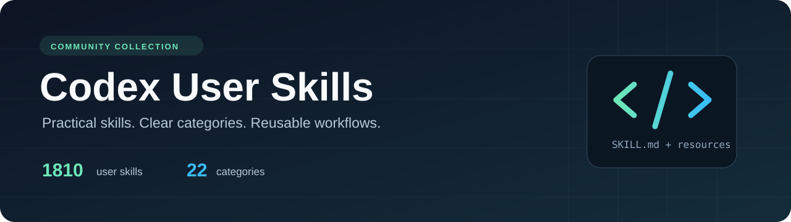

[Русский](README.md) | [English](README.en.md)

<p align="center">
  
</p>

# Codex User Skills

**User skills for OpenAI Codex, organized by topic.** The collection contains 1810 skills across 22 categories, covering software development, AI, documents, business, and everyday tasks. Each skill has its own `SKILL.md`; each category has a complete list of its skills and descriptions.

[](https://github.com/Slipcast-dev/codex-user-skills/actions/workflows/validate.yml)
[](CATALOG.en.md)
[](CATALOG.en.md)
[](https://github.com/Slipcast-dev/codex-user-skills/releases/latest)
[](https://github.com/Slipcast-dev/codex-user-skills/releases)
[](https://github.com/Slipcast-dev/codex-user-skills/stargazers)
[](https://github.com/Slipcast-dev/codex-user-skills/commits/main)
[](https://developers.openai.com/codex/skills)
[](README.md)
[](THIRD_PARTY_NOTICES.en.md)

An independent community collection. This repository is not an official OpenAI product and does not imply endorsement or support from OpenAI. Bundled Codex system skills and skills from installed plugins are excluded.

Documentation and navigation are available in Russian and English. Skill instructions and resources are preserved in their source languages. Most descriptions were originally written in English; Russian descriptions have English translations in the English catalog. The main repository README is [in Russian](README.md).

## Categories and search

Open **[the complete catalog](CATALOG.en.md)** for every category, its skill count, and links to detailed lists. Each category page lists all of its skills and their purposes.

| Topic | Page |
| --- | --- |
| AI, Codex, and agents | [Skill list](categories/agents-ai.en.md) |
| Software development and architecture | [Skill list](categories/development.en.md) |
| DevOps, cloud, and operations | [Skill list](categories/devops-cloud.en.md) |
| Security and privacy | [Skill list](categories/security-privacy.en.md) |
| Data and analytics | [Skill list](categories/data-analytics.en.md) |
| Design and creativity | [Skill list](categories/design-creative.en.md) |
| Product and strategy | [Skill list](categories/product-strategy.en.md) |
| Marketing, SEO, and growth | [Skill list](categories/marketing-growth.en.md) |
| Writing and communication | [Skill list](categories/writing-communication.en.md) |
| All 22 categories | **[Open the catalog](CATALOG.en.md)** |

Categories provide editorial navigation by purpose. Each skill has one primary category; it does not identify the author or license. To search the whole collection, use [the machine-readable catalog](catalog/skills.json) or GitHub search within this repository.

## Install one skill

Start by reading its `SKILL.md`, related files, and license. A skill may require separate applications, libraries, MCP connections, or other skills. These dependencies are not installed automatically.

### Through Codex

If `$skill-installer` is available in your installation, send Codex this request:

```text
$skill-installer Install the skill from https://github.com/Slipcast-dev/codex-user-skills/tree/main/skills/focused-fix
```

For skill locations, discovery, and invocation, see [the official Codex documentation](https://developers.openai.com/codex/skills).

### Manual installation: macOS and Linux

Git must be installed. This example copies one skill into the user directory `~/.agents/skills` and skips the copy if a folder with the same name already exists:

```sh
git clone https://github.com/Slipcast-dev/codex-user-skills.git
cd codex-user-skills
mkdir -p "$HOME/.agents/skills"
if [ -e "$HOME/.agents/skills/focused-fix" ]; then
  echo "The focused-fix skill already exists. Back it up or rename it first."
else
  cp -R skills/focused-fix "$HOME/.agents/skills/"
fi
```

### Manual installation: Windows PowerShell

```powershell
git clone https://github.com/Slipcast-dev/codex-user-skills.git
Set-Location codex-user-skills
$skillsDirectory = Join-Path $HOME '.agents/skills'
$destination = Join-Path $skillsDirectory 'focused-fix'
New-Item -ItemType Directory -Force -Path $skillsDirectory | Out-Null
if (Test-Path $destination) {
    throw 'The focused-fix skill already exists. Back it up or rename it first.'
}
Copy-Item -Recurse -Path 'skills/focused-fix' -Destination $destination
```

Copy **the complete skill folder**, including `WORKFLOW.md`, `references/`, `scripts/`, and license files when present. Restart Codex if the skill does not appear, then mention it in your request using `$focused-fix`.

These commands describe manual file placement. They do not establish that every skill and its dependencies work on every operating system. The collection also excludes user agent definitions from `.codex/agents`.

## Download the collection

A packaged archive is available on **[the latest release page](https://github.com/Slipcast-dev/codex-user-skills/releases/latest)**. Download the archive from **Assets**, extract it, and install selected skills using the instructions above.

The **release downloads** badge counts downloads of files attached to GitHub releases. It does not include `git clone`, automatically generated **Source code (zip/tar.gz)** archives, or individual skill installations. The badge is provided by [Shields.io](https://shields.io/badges/git-hub-downloads-all-assets-all-releases).

## Collection structure

```text
skills/<skill-name>/   Complete skill folder with SKILL.md and supporting files
categories/           Topic-based skill lists with descriptions, in RU and EN
catalog/              Machine-readable skills, categories, and provenance
assets/               Repository artwork
scripts/              Catalog maintenance tools
.github/              Checks and contribution templates
```

Folders in `skills/` remain side by side because some original instructions reference neighboring folders through `../`. Moving skills into physical category folders could break those links. Category navigation is stored separately. If a skill references a neighboring skill, check whether it is available and install it separately when needed.

## Licenses and provenance

The collection includes materials from different authors. **A single license does not automatically apply to every skill.** Each skill is governed by its original `LICENSE`, `NOTICE`, and other notices. These files are preserved alongside the skill.

See [THIRD_PARTY_NOTICES.en.md](THIRD_PARTY_NOTICES.en.md) for a summary and materials whose license is unspecified; [LICENSE](LICENSE) defines the scope of the repository's license. There is no separate license file for 135 skills. The source package and license for the added `systems-engineering` skill are unspecified. A missing license file does not automatically assign an MIT license or establish terms for downstream use. A catalog entry does not itself grant new rights to third-party materials. The original legal license text is preserved without translation.

## Contributing and support

- [Propose a correction or a new skill](CONTRIBUTING.en.md)
- [Code of conduct](CODE_OF_CONDUCT.en.md)
- [Report a vulnerability](SECURITY.en.md)
- [Questions and help](SUPPORT.en.md)
- [Changelog](CHANGELOG.en.md)

Issue templates, contributor instructions, and the security policy follow [GitHub's recommendations for public repositories](https://docs.github.com/en/communities/setting-up-your-project-for-healthy-contributions/about-community-profiles-for-public-repositories).
