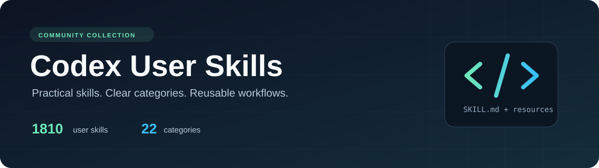

[Русский](README.md) | [English](README.en.md)

<p align="center">
  
</p>

# Codex User Skills

**Пользовательские навыки для OpenAI Codex, распределённые по темам.** В коллекции 1810 навыков и 22 категории: от разработки и ИИ до документов, бизнеса и личных задач. У каждого навыка есть собственный `SKILL.md`, а у каждой категории — полный список навыков с описаниями.

[](https://github.com/Slipcast-dev/codex-user-skills/actions/workflows/validate.yml)
[](CATALOG.md)
[](CATALOG.md)
[](https://github.com/Slipcast-dev/codex-user-skills/releases/latest)
[](https://github.com/Slipcast-dev/codex-user-skills/releases)
[](https://github.com/Slipcast-dev/codex-user-skills/stargazers)
[](https://github.com/Slipcast-dev/codex-user-skills/commits/main)
[](https://developers.openai.com/codex/skills)
[](README.en.md)
[](THIRD_PARTY_NOTICES.md)

Независимая коллекция сообщества. Репозиторий не является официальным продуктом OpenAI и не означает одобрения или поддержки со стороны OpenAI. Системные навыки Codex и навыки из установленных плагинов в коллекцию не входят.

Документация и навигация доступны на русском и английском языках. Инструкции и ресурсы самих навыков сохранены на исходных языках. Большинство описаний изначально на английском; для русских описаний в английском каталоге добавлен перевод. Полная английская версия: [README.en.md](README.en.md).

## Категории и поиск

Откройте **[полный каталог](CATALOG.md)**: он показывает все категории, количество навыков в каждой и ссылки на подробные списки. На странице категории перечислен каждый входящий в неё навык и его назначение.

| Направление | Страница |
| --- | --- |
| ИИ, Codex и агенты | [Список навыков](categories/agents-ai.md) |
| Разработка ПО и архитектура | [Список навыков](categories/development.md) |
| DevOps, облака и эксплуатация | [Список навыков](categories/devops-cloud.md) |
| Безопасность и приватность | [Список навыков](categories/security-privacy.md) |
| Данные и аналитика | [Список навыков](categories/data-analytics.md) |
| Дизайн и творчество | [Список навыков](categories/design-creative.md) |
| Продукт и стратегия | [Список навыков](categories/product-strategy.md) |
| Маркетинг, SEO и рост | [Список навыков](categories/marketing-growth.md) |
| Тексты и коммуникация | [Список навыков](categories/writing-communication.md) |
| Все 22 категории | **[Открыть каталог](CATALOG.md)** |

Категории — редакционная навигация по назначению навыков. У каждого навыка одна основная категория; она не описывает автора или лицензию. Для поиска по всей коллекции используйте [машиночитаемый каталог](catalog/skills.json) или поиск GitHub в этом репозитории.

## Установка одного навыка

Начните с чтения его `SKILL.md`, связанных файлов и лицензии. Навык может требовать отдельные программы, библиотеки, MCP-подключения или другие навыки. Они не устанавливаются автоматически.

### Через Codex

Если в вашей установке доступен `$skill-installer`, отправьте Codex запрос:

```text
$skill-installer Установи навык из https://github.com/Slipcast-dev/codex-user-skills/tree/main/skills/focused-fix
```

Подробнее о размещении, обнаружении и вызове навыков — в [официальной документации Codex](https://developers.openai.com/codex/skills).

### Вручную: macOS и Linux

Нужен установленный Git. Следующий пример копирует один навык в пользовательский каталог `~/.agents/skills` и не перезаписывает одноимённую папку, если она уже существует:

```sh
git clone https://github.com/Slipcast-dev/codex-user-skills.git
cd codex-user-skills
mkdir -p "$HOME/.agents/skills"
if [ -e "$HOME/.agents/skills/focused-fix" ]; then
  echo "Навык focused-fix уже существует. Сначала сохраните или переименуйте его."
else
  cp -R skills/focused-fix "$HOME/.agents/skills/"
fi
```

### Вручную: Windows PowerShell

```powershell
git clone https://github.com/Slipcast-dev/codex-user-skills.git
Set-Location codex-user-skills
$skillsDirectory = Join-Path $HOME '.agents/skills'
$destination = Join-Path $skillsDirectory 'focused-fix'
New-Item -ItemType Directory -Force -Path $skillsDirectory | Out-Null
if (Test-Path $destination) {
    throw 'Навык focused-fix уже существует. Сначала сохраните или переименуйте его.'
}
Copy-Item -Recurse -Path 'skills/focused-fix' -Destination $destination
```

Копируйте **всю папку навыка**, включая `WORKFLOW.md`, `references/`, `scripts/` и файлы лицензии, если они присутствуют. Перезапустите Codex, если навык не появился, и укажите его в запросе через `$focused-fix`.

Команды выше описывают ручное размещение файлов. Они не подтверждают, что каждый навык и его зависимости работают на всех операционных системах. Сборник также не включает пользовательские определения агентов из `.codex/agents`.

## Скачать коллекцию

Готовый архив доступен на странице **[последнего релиза](https://github.com/Slipcast-dev/codex-user-skills/releases/latest)**. Скачайте архив из раздела **Assets**, распакуйте его и установите выбранные навыки по инструкции выше.

Бейдж **release downloads** считает скачивания файлов, прикреплённых к релизам GitHub. Он не включает `git clone`, автоматические архивы **Source code (zip/tar.gz)** и число установок отдельных навыков. Источник бейджа — [Shields.io](https://shields.io/badges/git-hub-downloads-all-assets-all-releases).

## Структура коллекции

```text
skills/<имя-навыка>/   Полная папка навыка с SKILL.md и дополнительными файлами
categories/           Списки всех навыков по темам с описаниями
catalog/              Машиночитаемый каталог, категории и происхождение
assets/               Оформление репозитория
scripts/              Инструменты сопровождения каталога
.github/              Проверки и шаблоны обращений
```

Папки в `skills/` расположены рядом: исходные инструкции некоторых навыков ссылаются на соседние папки через `../`. Перенос по физическим папкам категорий мог бы нарушить эти ссылки. Навигация по категориям хранится отдельно. Если выбранный навык ссылается на соседний, проверьте его наличие и установите отдельно при необходимости.

## Лицензии и происхождение

Коллекция содержит материалы разных авторов. **Единая лицензия не распространяется автоматически на все навыки.** Условия каждого навыка определяются его исходными `LICENSE`, `NOTICE` и другими уведомлениями. Они сохранены вместе с файлами.

Сводка и материалы с неустановленной лицензией описаны в [THIRD_PARTY_NOTICES.md](THIRD_PARTY_NOTICES.md); правила применения лицензии репозитория — в [LICENSE](LICENSE). Для 135 навыков файл лицензии отсутствует. Для добавленного `systems-engineering` источник пакета и лицензия не указаны. Отсутствие файла лицензии не назначает автоматически лицензию MIT и не устанавливает условия дальнейшего использования. Запись в каталоге сама по себе не предоставляет новых прав на чужие материалы.

## Участие и поддержка

- [Как предложить исправление или новый навык](CONTRIBUTING.md)
- [Правила общения](CODE_OF_CONDUCT.md)
- [Сообщить об уязвимости](SECURITY.md)
- [Вопросы и помощь](SUPPORT.md)
- [История изменений](CHANGELOG.md)

Шаблоны обращений, инструкции для участников и политика безопасности подготовлены с учётом [рекомендаций GitHub для публичных репозиториев](https://docs.github.com/en/communities/setting-up-your-project-for-healthy-contributions/about-community-profiles-for-public-repositories).
